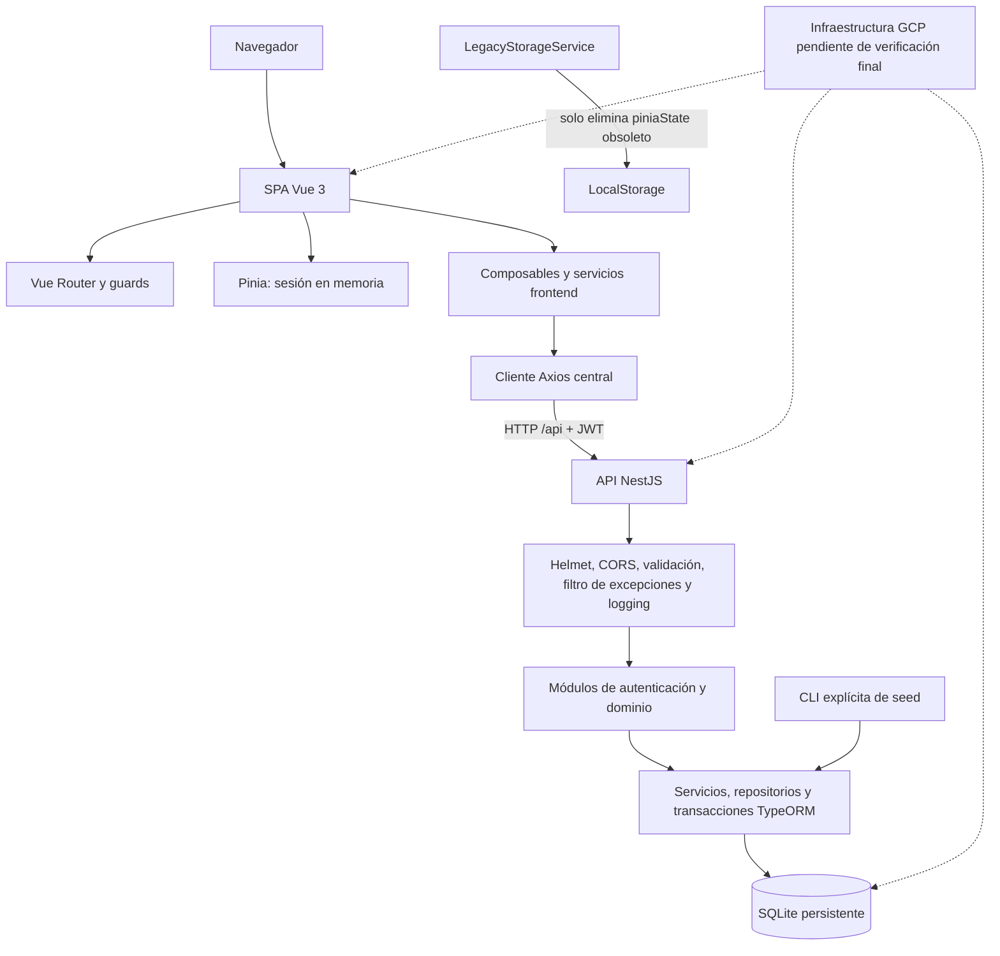
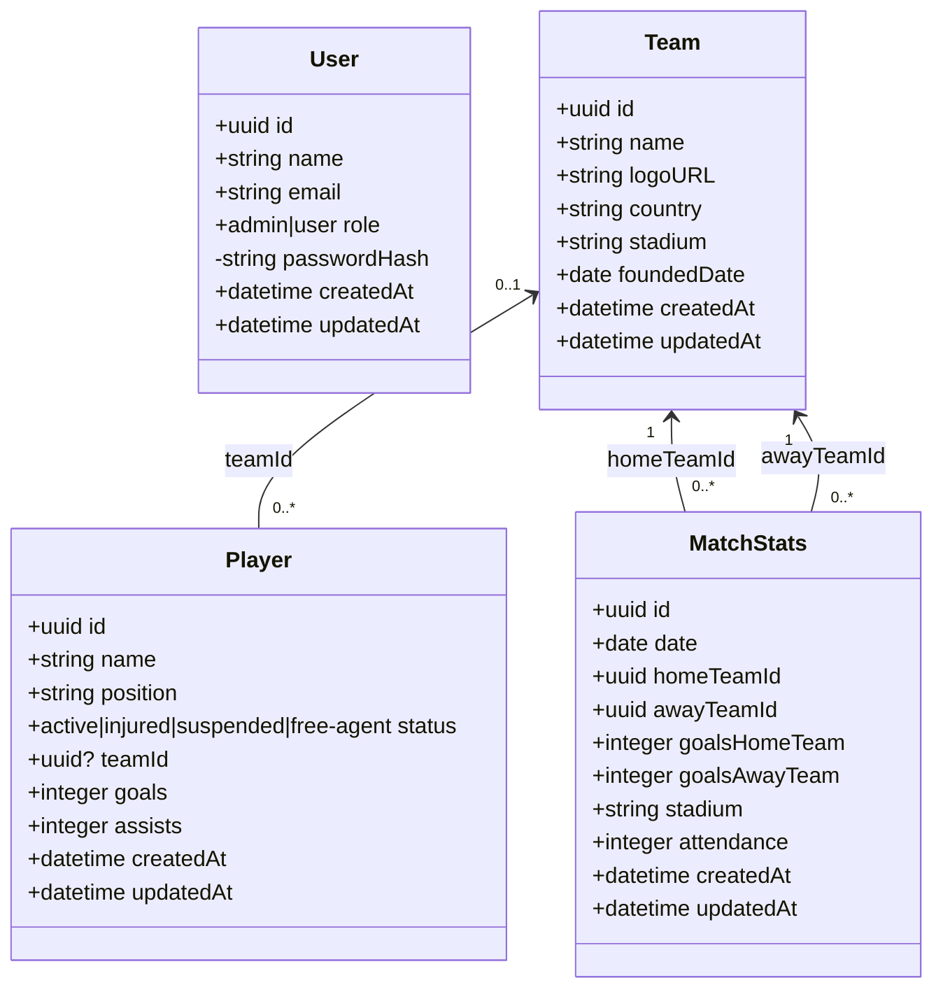
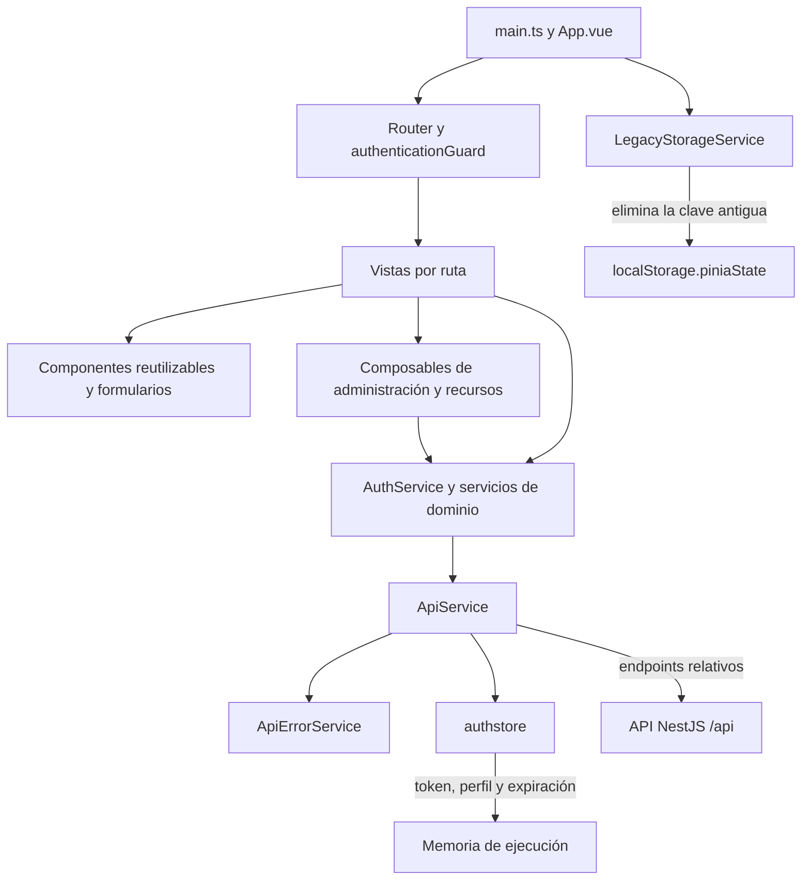
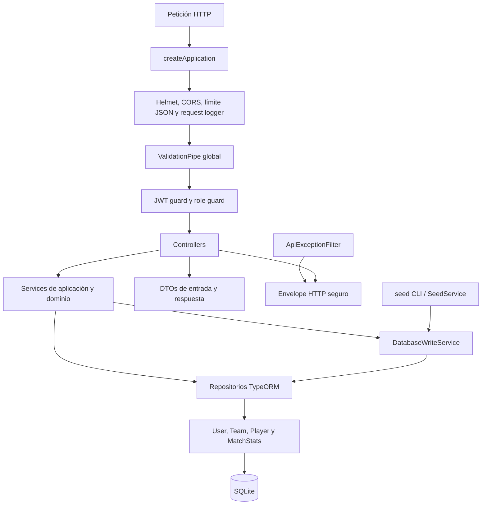

# Entregable 2: Soccer Dashboard full stack

## 1. Propósito

El Entregable 2 reemplaza el modelo de datos almacenado en el navegador de la primera entrega por una arquitectura full stack. La aplicación Vue consume una API REST NestJS, los datos persistentes se almacenan en SQLite mediante TypeORM y la autenticación se verifica en el backend con JWT.

Esta página describe lo que ya está implementado en `main`. No es una propuesta futura.

Repositorio oficial: <https://github.com/pipeagudelo3/soccer-dashboard>

## 2. Tecnologías vigentes

| Área | Tecnologías |
| --- | --- |
| Frontend | Vue 3, TypeScript, Composition API, Vue Router, Pinia, Axios y Vite |
| Visualización | Chart.js y SweetAlert2 |
| Backend | NestJS, TypeScript y API REST |
| Persistencia | TypeORM, SQLite, migraciones y transacciones |
| Seguridad | JWT, bcrypt, Helmet, CORS, DTO validation, guards y sanitización de errores |
| Pruebas | Node test runner, Jest, Supertest y bases SQLite aisladas |
| Calidad | Prettier, ESLint, TypeScript, `vue-tsc`, builds y auditorías npm |

Tailwind CSS no forma parte del proyecto. Los estilos se implementan con CSS propio.

## 3. Arquitectura general



Fuente: [`docs/diagrams/system-architecture.mmd`](../diagrams/system-architecture.mmd).

La dirección de dependencias es frontend → API → servicios backend → repositorios → SQLite. El navegador nunca accede directamente a la base de datos.

## 4. Modelo de dominio



Fuente: [`docs/diagrams/domain-class-diagram.mmd`](../diagrams/domain-class-diagram.mmd).

| Entidad | Responsabilidad | Relación y política |
| --- | --- | --- |
| `User` | Identidad, rol y hash de contraseña | Agregado independiente; `passwordHash` no se selecciona normalmente ni se serializa |
| `Team` | Identidad deportiva, país, estadio y fundación | Referenciado por jugadores y partidos |
| `Player` | Estado y contribuciones del jugador | `teamId` opcional; al borrar el equipo se establece `null` |
| `MatchStats` | Resultado, estadio y asistencia | Equipos local/visitante obligatorios y diferentes; el borrado del equipo se restringe |

En DTOs, contratos REST y fixtures de seed, las relaciones se representan por IDs (`teamId`, `homeTeamId`, `awayTeamId`). Las propiedades de navegación ORM son internas y no forman parte del contrato público.

## 5. Arquitectura frontend



Fuente: [`docs/diagrams/frontend-architecture.mmd`](../diagrams/frontend-architecture.mmd).

### Responsabilidades

- **Vistas:** componen la página, mantienen filtros de presentación y coordinan estados de carga, vacío, error y éxito.
- **Componentes:** encapsulan formularios y patrones visuales reutilizables mediante props y emits tipados.
- **Composables:** reutilizan orquestación reactiva, control de concurrencia y ciclos de vida.
- **Servicios de dominio:** seleccionan endpoints, transforman DTOs y devuelven `ServiceResult<T>`.
- **`ApiService`:** único cliente Axios autenticado; agrega el JWT y normaliza el transporte.
- **`ApiErrorService`:** convierte errores técnicos en mensajes seguros y predecibles.
- **`authstore`:** conserva únicamente la sesión actual en memoria.
- **Router guards:** evitan navegación incorrecta y esperan la verificación de sesión; no sustituyen la autorización del backend.
- **Utilidades analíticas:** calculan métricas puras sin ejecutar HTTP ni mutar datos fuente.

## 6. Arquitectura backend



Fuente: [`docs/diagrams/backend-architecture.mmd`](../diagrams/backend-architecture.mmd).

### Responsabilidades

- **Módulos:** registran dependencias y límites funcionales.
- **Controllers:** traducen HTTP, declaran DTOs/guards y delegan en services.
- **DTOs y `ValidationPipe`:** validan y transforman entradas externas, rechazan campos desconocidos.
- **Guards:** validan JWT y rol administrador en el servidor.
- **Services:** aplican reglas de negocio, controlan conflictos y coordinan lecturas/escrituras.
- **`DatabaseWriteService`:** ejecuta operaciones multi-entidad de forma transaccional.
- **Repositorios/entidades:** persisten datos y refuerzan invariantes con claves, índices, relaciones y `CHECK`.
- **`ApiExceptionFilter`:** genera un envelope de error estable sin revelar detalles internos.
- **Configuración:** valida variables de entorno antes de iniciar.
- **Swagger:** documenta el contrato HTTP registrado.

## 7. Flujos principales

### Inicio de sesión y validación

1. La vista entrega el DTO a `AuthService`.
2. El servicio envía el correo normalizado y la contraseña exacta a `POST /api/auth/login`.
3. El backend compara el hash bcrypt y devuelve JWT, expiración y perfil seguro.
4. `authstore` conserva la sesión en memoria.
5. Las comprobaciones posteriores consultan el backend y actualizan o eliminan la sesión.

### Petición protegida

1. Un servicio solicita un endpoint relativo a `ApiService`.
2. El interceptor verifica expiración y agrega `Authorization: Bearer ...`.
3. El JWT guard del backend valida identidad; el role guard valida administración cuando corresponde.
4. Un `401` coincidente elimina la sesión activa sin reintentos ni bucles de redirección.

### CRUD administrativo

1. La vista usa un composable y un servicio de dominio.
2. El controller valida DTO, identidad y rol.
3. El service aplica reglas de negocio y usa repositorios/transacciones.
4. La respuesta vuelve como `ServiceResult<T>` y la UI conserva el formulario abierto si falla.

### Lecturas y analítica

1. Los servicios obtienen equipos, jugadores y partidos desde la API.
2. Composables/vistas gestionan carga y errores.
3. Las utilidades analíticas calculan métricas sin modificar los arreglos recibidos.
4. Tablas y Chart.js presentan los resultados filtrados.

### Seed explícito

1. El desarrollador ejecuta `npm run seed` en `backend`.
2. La CLI crea el contexto de seed; no se ejecuta al iniciar la API.
3. La transacción resuelve equipos antes que jugadores/partidos.
4. Las contraseñas se convierten a hashes.
5. Los IDs existentes se omiten; un fallo revierte la operación completa.

## 8. Estado y persistencia

- SQLite es la única base persistente del dominio.
- Pinia no es una base de datos: solo mantiene la autenticación en memoria.
- LocalStorage no guarda usuarios, equipos, jugadores, partidos, JWT ni perfiles.
- `LegacyStorageService` únicamente elimina la clave obsoleta `piniaState`.
- Los seeders viven exclusivamente en el backend y se ejecutan por CLI.

Véase [Estado, persistencia y seeders](State-Persistence-and-Seeding.md).

## 9. Ejecución local

Backend:

```powershell
cd backend
Copy-Item .env.example .env
npm ci
npm run migration:run
npm run seed
npm run start:dev
```

Frontend, en otra terminal:

```powershell
cd frontend
Copy-Item .env.example .env
npm ci
npm run dev
```

La URL base de la API y el origen CORS deben coincidir con los puertos reales.

## 10. Verificación

```powershell
cd frontend
npm ci
npm run verify
npm audit --omit=dev

cd ../backend
npm ci
npm run verify
npm audit --omit=dev

cd ..
git diff --check
git status --short
```

La prueba manual debe cubrir login/logout, permisos, CRUD, relaciones, filtros, tablas, gráficos, errores, recarga, navegación móvil y teclado.

## 11. Despliegue

`main` contiene actualmente una primera imagen del frontend servida por Nginx. Este es un paso preliminar y no equivale todavía al despliegue full stack aprobado: faltan integrar/verificar el contenedor backend, Compose, health checks, configuración de la API y persistencia del volumen SQLite. La construcción definitiva tampoco debe depender de artefactos `dist` generados manualmente y versionados.

La infraestructura final en GCP se documentará únicamente después de verificar el stack Docker/Compose, la URL pública, CORS, persistencia del volumen y reinicios. Hasta entonces, los diagramas marcan GCP como destino pendiente y no afirman una ruta pública inexistente.

## 12. Mantenimiento documental

- Un cambio de arquitectura, herramientas, contratos o persistencia debe actualizar estos documentos en el mismo PR.
- Los diagramas se versionan como Mermaid para poder revisar diferencias.
- El Markdown del repositorio se revisa antes de copiarse a la Wiki.
- No deben volver a presentarse `PiniaConfig.ts`, stores/seeders frontend ni LocalStorage como arquitectura vigente.

